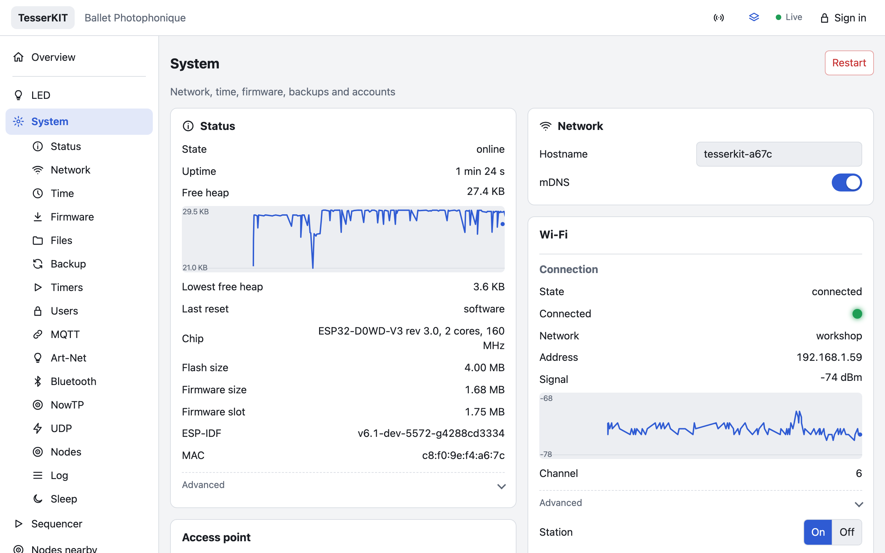
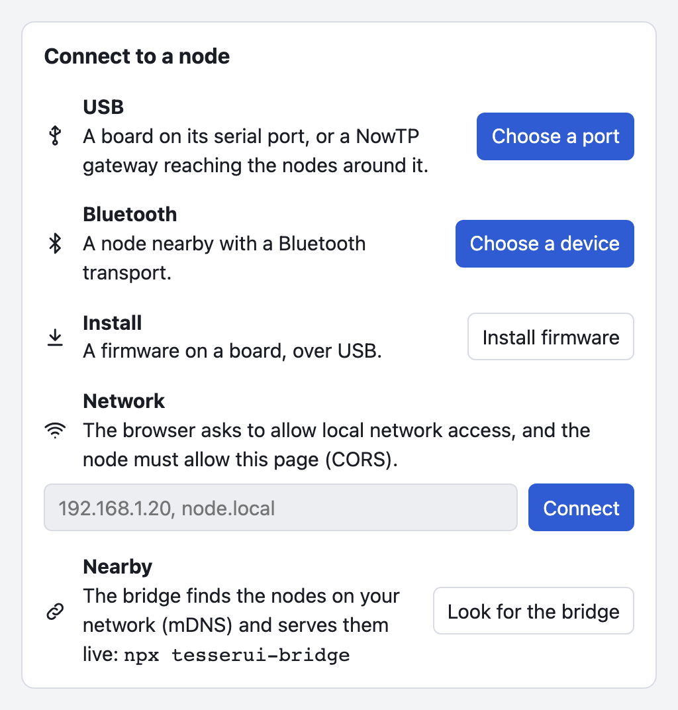
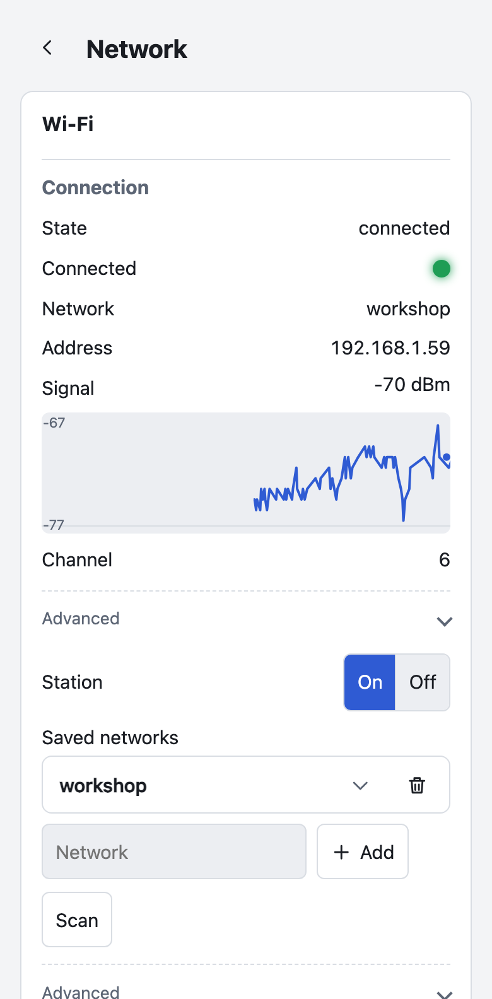
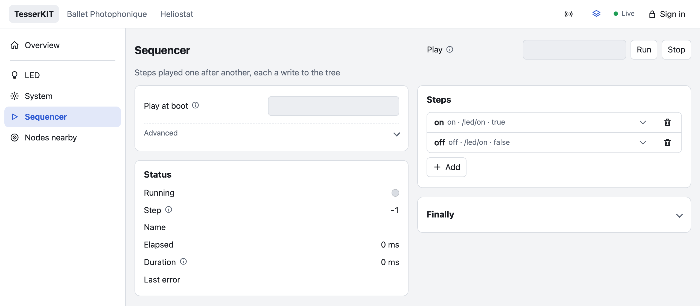

# TesserKIT

A device framework for ESP32 firmware with a rich web interface and a small footprint. It provides what every connected device needs besides its own function: network setup, time, firmware updates, backups, files, users, MQTT (with Home Assistant discovery), Art-Net, Bluetooth, ESP-NOW, the log, the battery, deep sleep and system status. Each is a subtree of a [TesserAPI](https://github.com/leokeba/TesserAPI) tree, drawn by [TesserUI](https://github.com/leokeba/TesserUI)'s generic renderer, with no UI code.

<picture>
  <source media="(prefers-color-scheme: dark)" srcset="docs/images/system-dark.png">
  
</picture>

> **Status: phases 1, 2 and 5 done, part of 4.** Device, System, Network (Wi-Fi and Ethernet), Time, Firmware, Backup, Files, Timers, Sequencer, Auth, Mqtt (with Home Assistant discovery), ArtNet, Bluetooth, NowTp, UdpApi, Peers, Log, Battery and Sleep work on the host (215 test cases) and on hardware: classic ESP32 with ESP-IDF and Arduino, and a Gledopto Ethernet controller, checked by the `test/e2e_*.py` scripts. ESP32-C3 and ESP32-S3 builds are released, but less tried. Releases are published from each push to main ([latest](https://github.com/leokeba/TesserKIT/releases/latest)). Porting helionext is under way in its own repository. The specification is [docs/DESIGN.md](docs/DESIGN.md).

## At a glance

```cpp
#include <TesserKIT.h>

tesserkit::Device dev("Heliostat");
tesserkit::System sys(dev);           // /sys/status, restart, factory reset, core dump
tesserkit::Network net(dev);          // Wi-Fi, access point, captive portal, mDNS
tesserkit::Time timekeeper(dev);      // SNTP, time zone, set from the browser
tesserkit::Firmware firmware(dev);    // upload, rollback; .downloads() for URLs, .github() for releases
tesserkit::Backup backup(dev);        // download and restore the settings, or store them on the device
tesserkit::Files files(dev);          // LittleFS: browse, upload, download (optional, needs a partition)
tesserkit::Timers timers(dev);        // daily schedules over the whole tree
tesserkit::Sequencer sequencer(dev);  // steps played in turn, each a write to the tree
tesserkit::Auth auth(dev);            // accounts, roles, sign-in
tesserkit::Bluetooth bluetooth(dev);  // the interface from a phone, over Bluetooth LE
tesserkit::NowTp espNow(dev);         // the nodes nearby over ESP-NOW, each with its page (not "nowtp": NowTP's namespace)
tesserkit::UdpApi udp(dev);           // the nodes on the LAN over UDP, and writes to all of them at once
tesserkit::Peers peers(dev);          // how the nodes are reached: UDP, NowTP, in which order
tesserkit::Log logs(dev);             // the firmware's log lines, live and as a file
tesserkit::Battery battery(dev);      // charge and voltage: .adc(pin) or .update() from a fuel gauge
tesserkit::Sleep sleeper(dev);        // deep sleep, woken by a timer or a pin

void setup() {
    dev.api().mount("heliostat", heliostat);   // the application's own tree
    dev.begin();
}
void loop() {}
```

Declare only the services you need, one line each; the interface shows those that are there.

It aims at most of [ESP32-sveltekit](https://github.com/theelims/ESP32-sveltekit)'s functionality, as:

- a library rather than a template;
- every service is a subtree reachable over HTTP, WebSocket, serial, Bluetooth, ESP-NOW, UDP and MQTT. Firmware, backups and files are included: they transfer in chunks where there is no HTTP;
- the whole interface fits in a 50 KB bundle;
- settings live in NVS, with a filesystem partition only for the optional Files service.

## Getting started

**From the browser.** Open the launcher, [leokeba.github.io/TesserKIT](https://leokeba.github.io/TesserKIT/), in Chrome. It installs the latest release on a board over USB and sets up its Wi-Fi. It also reaches a device over USB or Bluetooth with no network at all, by its address, or among the devices [TesserUI's bridge](https://github.com/leokeba/TesserUI/tree/main/bridge) finds nearby.

The bridge runs on your machine, finds the devices on its network and serves the launcher at `http://localhost:8765/`, where it also installs the latest releases. On a Mac it is a single executable with nothing to install: download it for [Apple silicon](https://github.com/leokeba/TesserKIT/releases/latest/download/tesserkit-bridge-macos-arm64.zip) or [Intel](https://github.com/leokeba/TesserKIT/releases/latest/download/tesserkit-bridge-macos-x64.zip), unzip it and double-click `tesserkit-bridge`, which runs in a Terminal window. It isn't notarized: macOS refuses it the first time, then *System Settings › Privacy & Security* offers *Open Anyway*. Elsewhere, run [TesserUI's bridge](https://github.com/leokeba/TesserUI/tree/main/bridge) with Node.



**On a phone.** A fresh device opens an access point named after it (`heliostat-a67c`) with a captive portal. Join it from a phone and the interface opens. Add a Wi-Fi network there; once the device has joined it, it is at `http://heliostat-a67c.local/`. The same pages work at phone width, with the menu in a drawer.



**From source.** Build `examples/idf/minimal` with ESP-IDF, or `examples/arduino/Minimal` with PlatformIO (see [Building](#building)).

## Services

| Service | Path | What it does |
|---|---|---|
| `System` | `/sys/status`, `/sys/restart`, ... | Chip, heap (charted), uptime, reset reason; restart, factory reset, core dump download |
| `Network` | `/sys/network` | Saved networks (a keyed list; passwords are never readable), scan, station state machine with backoff, access point (always, when offline, never), captive portal, mDNS. Ethernet on boards that have it (`net.ethernet(tesserkit::boards::gledopto())`), with the station always, never, or as a fallback to Ethernet's DHCP lease, and a link-local address on a cable without DHCP. Each interface says why it is in its state |
| `Time` | `/sys/time` | SNTP, POSIX time zone (the interface picks it from IANA names), set from the browser's clock, external sources (GPS, RTC) |
| `Firmware` | `/sys/firmware` | Upload with progress, checked for the chip before anything is written; download from a URL, and updates from GitHub releases checked daily on the device (opt-in); confirmation after a minute online, rollback |
| `Backup` | `/sys/backup` | The persisted state as JSON, secrets included (Admin only), restored leniently across firmware versions. With Files, backups stored on the device (by date, the oldest pruned), restored in a click, and the settings a restore replaced kept as `before-restore` |
| `Files` | `/sys/files` | A LittleFS partition browsed one directory at a time: upload, download, rename, delete, new directories. An upload replaces a file entirely or not at all. Needs a `files` partition (`partitions/tesserkit_4mb_files.csv`) or Arduino's `spiffs` |
| `Timers` | `/sys/timers` | Daily schedules on chosen weekdays: set any value or call any action of the tree at a local time |
| `Sequencer` | `/sequencer` | Steps played in turn, each a write to the tree (here or on the nodes under `/peers`), waiting a time or until the write's reply; steps by name or index, the next step by name, index or offset; a `finally` write when it stops; played at boot |
| `Auth` | `/sys/auth` | Accounts with user and admin roles, salted PBKDF2 hashes, stateless signed tokens, sign-in from TesserUI's dialog |
| `Mqtt` | `/sys/mqtt` | A broker bridge: chosen subtrees published as retained topics, one per leaf, with intervals; `<prefix>/<path>/set` commands with user access; online/offline availability; TLS with the certificate bundle (opt-in). Home Assistant discovery announces each value and action as a switch, number, select, text, sensor or button, from its schema |
| `Bluetooth` | `/sys/bluetooth` | TesserAPI's Bluetooth LE transport, for TesserUI's launcher on a phone: on and off at runtime, named after the hostname, the client shown; clients sign in with a token |
| `NowTp` | `/sys/nowtp`, `/peers` | NowTP over ESP-NOW. The TesserAPI nodes nearby are mounted under `/peers`, each with its page (a UI host), and this device appears on theirs. Pairing with an installation key, whose holders are trusted; channel following, network time, the nodes heard. A gateway relays its peers' firmware updates and files |
| `UdpApi` | `/sys/udp`, `/peers` | TesserAPI's API over UDP on the local networks, Ethernet or Wi-Fi. The nodes found there are mounted under `/peers` (once, if NowTP reaches them too). `send` writes to every node at once in one broadcast (a sequence started everywhere), or to one node with its reply. A level for nodes without a token |
| `Peers` | `/sys/peers` | How the nodes under `/peers` are reached. A device reached over UDP and NowTP is one node with a route per transport, tried in the order set (for every node, or per device by its MAC), the next one when it is lost. Devices declared by address; signing in to the nodes with an account, for more than their level for nodes; each node's state, route, round trip and last heard. Toasts when a node is lost or reached another way; the application is told when a device that wrote here is gone from every transport |
| `Log` | `/sys/log` | The firmware's log lines (ESP-IDF's and TesserKIT's) as live events, and the last 4 KB as a file; the log level, the console's too (Admin only) |
| `Battery` | `/sys/battery` | Charge, voltage and charging state, from an ADC pin through a divider (calibrated, smoothed) or the application's fuel gauge; a lithium curve or a straight line; a toast when it runs low |
| `Sleep` | `/sys/sleep` | Deep sleep for a time or until a wake pin (ext1, or the GPIO wake-up on the C3), `dev.onSleep()` to park the hardware first, and what woke this boot. Sleep is an action, so timers and sequences can call it |
| `ArtNet` | `/sys/artnet` | An Art-Net node: DMX channels of one universe (8 or 16 bits, scaled, or gates) written to any nodes, only when they change; answers ArtPoll |

Without the Auth service, or until it holds an admin account, the device is open: every client is Admin.

Timers, the Sequencer, Art-Net mappings and MQTT commands all act on the same tree, so they reach the application's values and every other service's actions without glue code. A sequence's steps can also write to other nodes under `/peers`, or to all of them at once with `/peers/*/...`.



## Footprint

Flash added on a classic ESP32 with ESP-IDF and `-Os`, above TesserAPI and TesserUI:

| What | Flash |
|---|---|
| Device, System, Network, Time, Firmware and Backup | 113 KB; 78 KB without mDNS (`CONFIG_TESSERKIT_MDNS=n`, or `-DTESSERKIT_NO_MDNS`) |
| Firmware downloads from URLs (TLS and an HTTP client), only with `firmware.downloads()` | about 130 KB |
| GitHub releases, only with `firmware.github()` | 10 KB more |
| ArtNet | 9 KB |
| Files (LittleFS) | 41 KB |
| Ethernet, only when declared | 41 KB |
| Log, Sleep and Home Assistant discovery together | 29 KB |
| Battery on an ADC pin | 12 KB |
| UdpApi | 18 KB, and 11 KB of RAM while running |
| Mqtt (esp-mqtt with its transports) | about 110 KB |
| Bluetooth on ESP-IDF | about 200 KB |

Every service and transport together (`examples/idf/full`) is 1.69 MB on ESP32 in release v0.1.18, 97% of an app slot of `partitions/tesserkit_4mb_files.csv`. Mqtt doesn't fit in Arduino's default 1.25 MB app slot next to every other service on ESP32. Details in [DESIGN §11](docs/DESIGN.md#11-footprint).

## Building

| Target | Example | Notes |
|---|---|---|
| ESP-IDF | `examples/idf/minimal` | Finds TesserAPI and TesserUI next to this repository, or through `TESSERAPI_PATH` and `TESSERUI_PATH`. Its `sdkconfig.defaults` selects `partitions/tesserkit_4mb.csv`, rollback and core dumps |
| Arduino / PlatformIO | `examples/arduino/Minimal` | With TesserAPI, TesserUI and ArduinoJson 7 |
| Bluetooth | `examples/idf/bluetooth`, `examples/arduino/Bluetooth` (ESP32-C3, ESP32-S3) | The Bluetooth service beside Wi-Fi: the launcher reaches the device from a phone with no network in common |
| Everything | `examples/idf/full` | Every service and transport with the factory defaults each one takes, and a dashboard; needs NowTP next to TesserKIT (or `NOWTP_PATH`). Battery with `-DBATTERY_GPIO=<adc pin>`; Bluetooth on ESP32 and ESP32-S3, not the C3, whose slot it wouldn't fit. Two boards running it show each other |
| Ethernet | `examples/idf/full -DETHERNET_BOARD=gledopto` | Or another preset of `tesserkit::boards`: the board's cable, and Wi-Fi when it is unplugged. The ESP32's internal MAC with an RMII PHY. On a Gledopto GL-C-611WL, firmware uploads run at 170 KB/s over the cable (70 KB/s over Wi-Fi) |

On a classic ESP32 without PSRAM, the full example is at the edge of the RAM: about 30 KB free, and HTTPS waits while an MQTT session runs (DESIGN §11).

## Testing

**On the host:**

```sh
cmake -S . -B build && cmake --build build -j && ctest --test-dir build
```

The services are platform-independent and tested against a fake platform.

**On hardware:**

| Script | What it checks |
|---|---|
| `python3 test/e2e_device.py http://<ip> [--image app.bin] [--crash-image crash.bin]` | Status, the interface, subscriptions, SNTP, sign-in, timers, persistence, backup and restore, OTA with confirmation and rollback |
| `uv run --with paho-mqtt python test/e2e_services.py http://<ip> --broker <host>` | ArtNet and Mqtt (the example built with `-DWITH_ARTNET=1 -DWITH_MQTT=1`) |
| `python3 test/e2e_github.py http://<ip> --image newer.bin --tag v9.9.9` | Updates from GitHub releases, against a local release server (instructions in the script) |
| `test/e2e_files.py`, `test/e2e_ethernet.py`, `test/e2e_transfers.py` | Files; Ethernet; transfers over serial and through a gateway |
| `uv run --with paho-mqtt python test/e2e_power.py http://<ip> --broker <host>` | Log, Sleep, Battery and Home Assistant discovery |
| `python3 test/e2e_udp.py http://<a> http://<b> [...]` | UDP between devices |

## Releases

Each push to main runs the host tests. Then [`release.yml`](.github/workflows/release.yml) builds the minimal and full examples for ESP32, ESP32-C3 and ESP32-S3 and publishes a release under the next patch version: `tesserkit-minimal-<target>.bin` and `tesserkit-full-<target>.bin` for updates, and `...-<target>-factory.bin` to flash a new board at 0x0. Devices running the example built with `-DWITH_GITHUB=1` find it and offer it under Firmware. The same run publishes the launcher to GitHub Pages, with the TesserUI that the release is built with and the latest three releases' factory images, which it installs. For a minor or major release, raise the version in `library.json`; `[skip ci]` in a commit message skips the release.

Applications release their own firmware with the same workflow:

```yaml
on:
  push:
    branches: [main]
jobs:
  firmware:
    permissions:
      contents: write
    uses: leokeba/TesserKIT/.github/workflows/firmware.yml@main
    with:
      project: firmware                  # the ESP-IDF project
      name: heliostat                    # assets: heliostat-esp32.bin, ...
      targets: '["esp32"]'
      dependencies: |                    # checked out next to the repository
        leokeba/TesserAPI
        leokeba/TesserUI
        leokeba/TesserKIT
```

and `firmware.github("owner/repo", "heliostat-{target}.bin")` in the firmware.

## Related

| Repository | Role |
|---|---|
| [TesserAPI](https://github.com/leokeba/TesserAPI) | The tree, its schema, transports (HTTP, WebSocket, serial, Bluetooth, NowTP, UDP), persistence and access control |
| [TesserUI](https://github.com/leokeba/TesserUI) | The web interface generated from the schema, served from flash in under 50 KB, and the launcher |
| [NowTP](https://github.com/leokeba/NowTP) | Reliable messaging over ESP-NOW, behind the NowTp service |

## License

MIT
